# Manual de Usuario — Pavanamoon
## Sistema de Gestión de Inventario y Distribución de Calzado

**Dirección:** https://grand-acceptance-production-0ac1.up.railway.app
**Navegadores:** Chrome, Edge o Firefox actualizados.

> **Sobre las capturas.** Se tomaron el 25/10/2026 recorriendo cada flujo en
> la aplicación (mismo código que la versión publicada, `main` `28f1176`),
> instalada en un entorno local con los datos de prueba del repositorio
> (`sql/dml`). En la versión publicada, los nombres y cantidades serán los de
> los datos ficticios de Railway. Desde el 27/10/2026 (PR #4), las fechas se
> muestran en hora de Guatemala.

## Contenido

1. [Ingreso al sistema](#1-ingreso-al-sistema)
2. [Qué puede hacer cada rol](#2-qué-puede-hacer-cada-rol)
3. [Bodega: productos, inventario, furgones e ingresos](#3-bodega)
4. [Kardex](#4-kardex)
5. [Ventas: clientes y pedidos](#5-ventas)
6. [Reportes](#6-reportes)
7. [Administración: empleados, usuarios y catálogos](#7-administración)
8. [Mensajes frecuentes](#8-mensajes-frecuentes)
9. [Preguntas frecuentes](#9-preguntas-frecuentes)

---

## 1. Ingreso al sistema

1. Abra la dirección del sistema.
2. Escriba su **Usuario** y su **Contraseña**, que le entrega el administrador.
3. Pulse **Ingresar**.

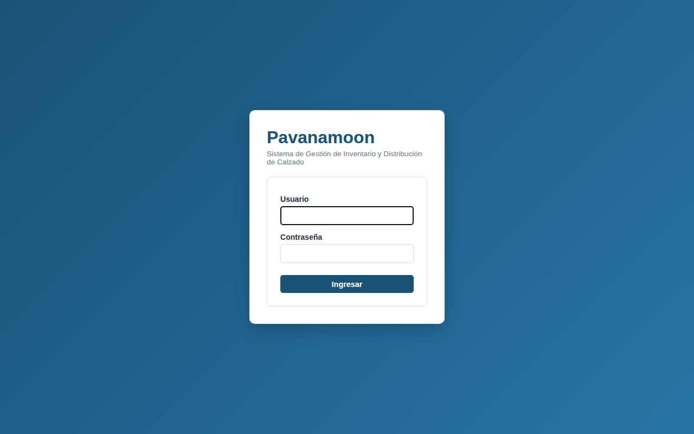

- Tras **5 intentos fallidos** el acceso se bloquea temporalmente (15 minutos
  por defecto) con el mensaje *"Demasiados intentos fallidos. Espera N
  minuto(s)…"*. Espere ese tiempo o pida al administrador que revise su usuario.
- Para salir, pulse **Cerrar sesión** (arriba a la derecha). Hágalo siempre en
  computadoras compartidas.

## 2. Qué puede hacer cada rol

Al entrar verá **solo los módulos de su rol**. En el encabezado aparecen su
nombre y su rol.

| Módulo | Administrador | Bodeguero | Vendedor |
|---|:---:|:---:|:---:|
| Productos | ✅ | ✅ | — |
| Inventario | ✅ | ✅ | ✅ (consulta) |
| Furgones | ✅ | ✅ | — |
| Ingresos | ✅ | ✅ | — |
| Clientes | ✅ | — | ✅ |
| Pedidos | ✅ | — | ✅ |
| Kardex | ✅ | ✅ | — |
| Reportes, Empleados, Usuarios, Catálogos | ✅ | — | — |

| Administrador | Bodeguero | Vendedor |
|---|---|---|
| 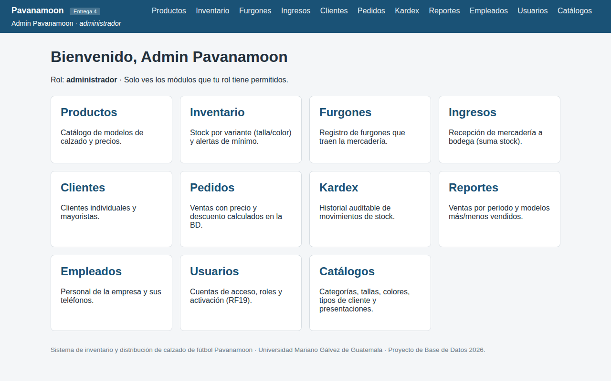 | 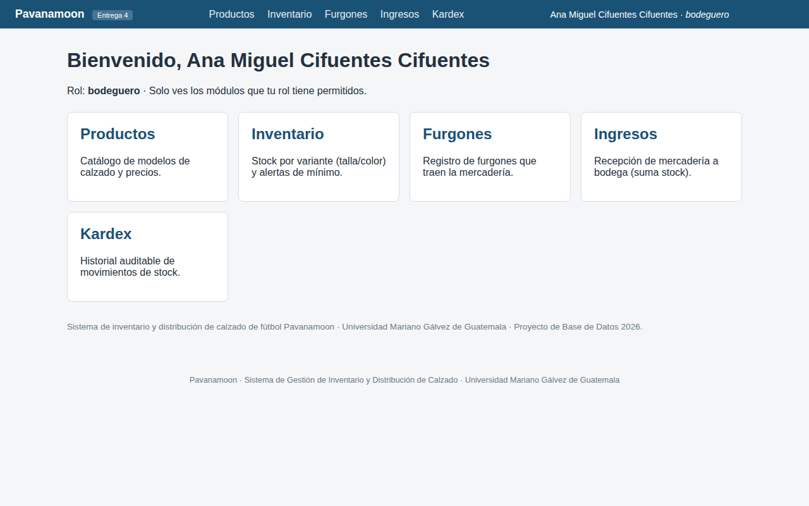 | 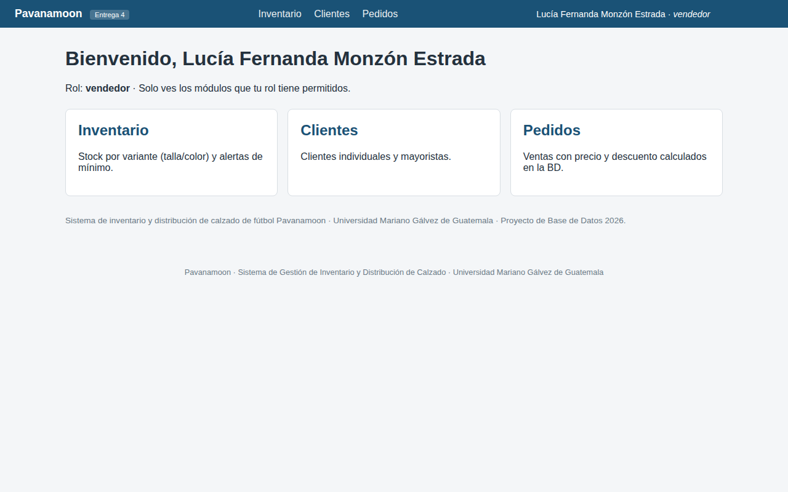 |

Si escribe a mano la dirección de un módulo que no le corresponde, el
sistema responde **"Acceso denegado"** (código 403):

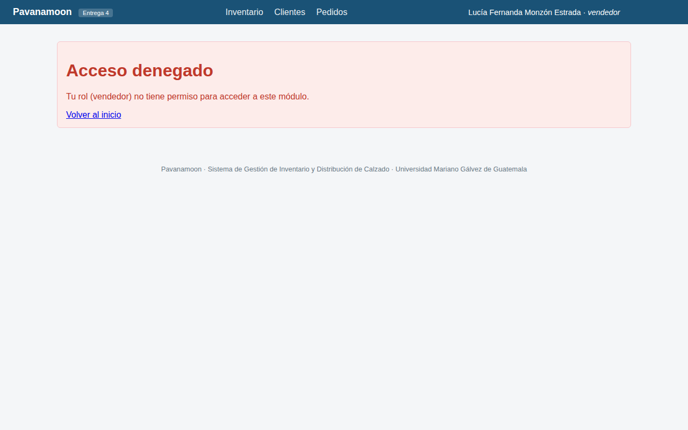

---

## 3. Bodega

### 3.1 Productos (modelos)

**Productos** lista los modelos con su categoría (Niño, Juvenil o Adulto),
tipo de suela (Hule, Flex o TPU) y **precio de venta por par**.

- **Nuevo:** llene Categoría, Modelo, Tipo de suela y Precio de venta (Q).
- **Editar:** permite, entre otras cosas, cambiar el precio (RF05). Los
  pedidos nuevos usarán el precio actualizado.
- **Eliminar:** solo es posible si el modelo no tiene variantes registradas.

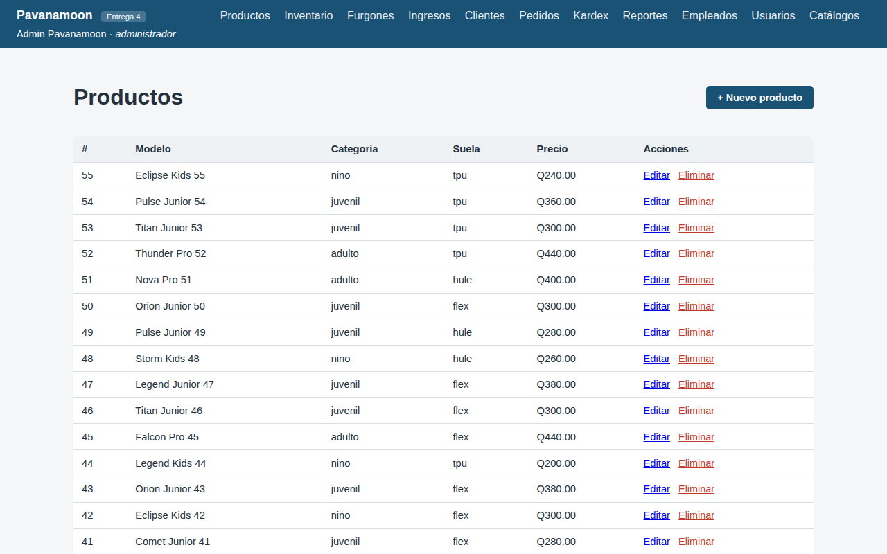

### 3.2 Inventario (variantes)

Cada **variante** es un modelo en una talla y un color, con su propio stock.
Puede buscar por SKU o por modelo. La columna **Estado** marca en alerta las
variantes con stock igual o menor al **stock mínimo** (RF04).

- **Nueva variante:** elija Producto, Talla, Color y Stock mínimo. El SKU se
  genera solo y el stock **inicia en 0**: solo aumenta con un ingreso de
  mercadería.
- **Editar:** si la variante ya tiene stock, solo se puede cambiar el stock
  mínimo.
- **Eliminar:** solo si la variante nunca tuvo movimientos.

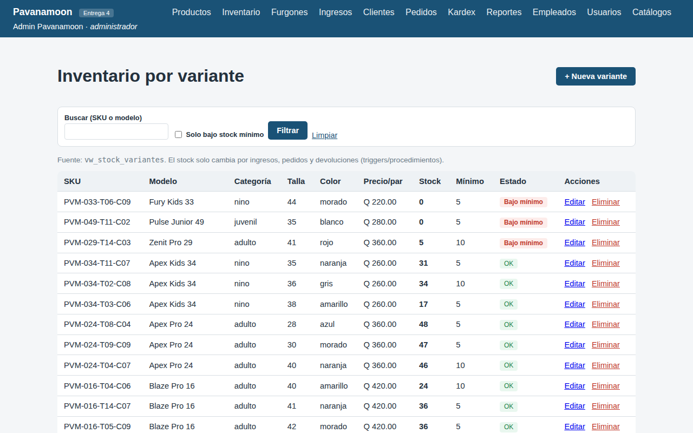

### 3.3 Furgones

Registre cada furgón que trae mercadería: **Número de furgón**, **Fecha de
llegada**, Procedencia, Transportista y Estado. El furgón debe existir antes
de registrar el ingreso de su carga.

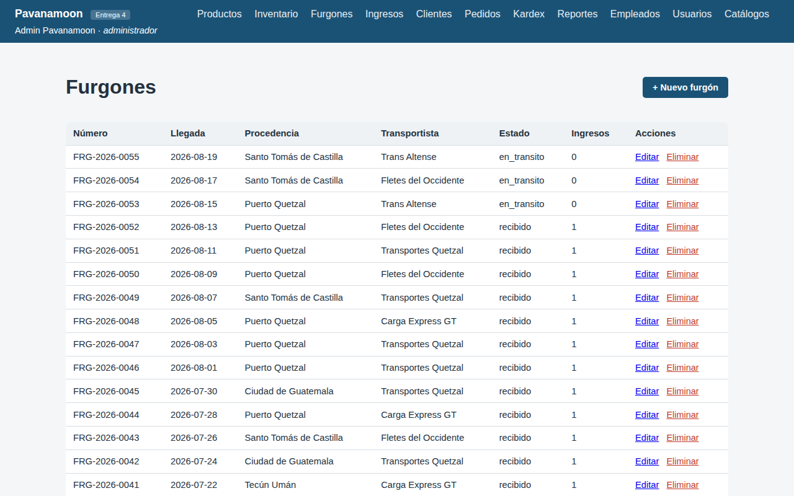

### 3.4 Registrar un ingreso de mercadería

1. Abra **Ingresos** y pulse **Nuevo**.
2. Elija el **Furgón** y escriba la **Bodega de destino**.
3. En cada fila, elija la **Variante** y escriba la **cantidad de pares** y el
   **costo unitario**. Deje vacías las filas que no use.
4. Pulse **Guardar ingreso**.

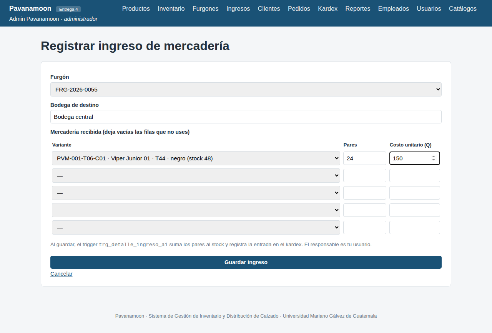

Al guardar, **el stock de cada variante aumenta automáticamente** y cada
línea queda registrada en el kardex como `entrada`, con usted como
responsable. Usted no ajusta el stock a mano.

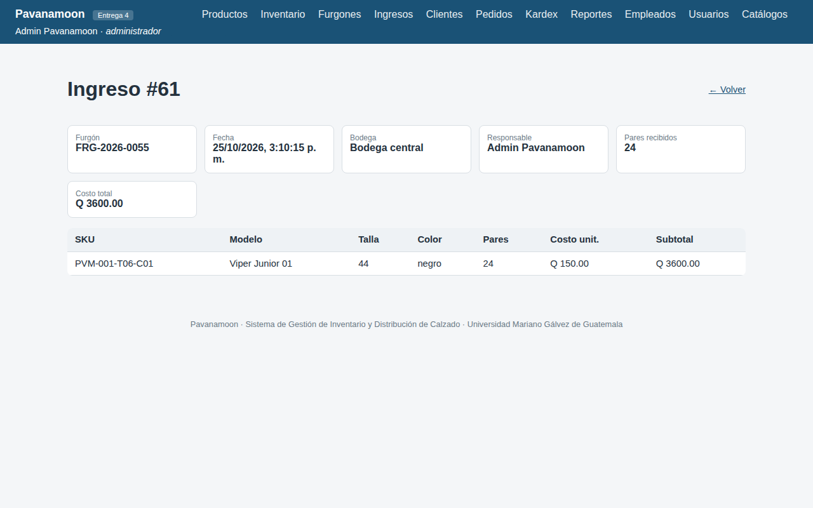

> Un ingreso guardado **no se edita ni se elimina**, porque ya modificó el
> stock y el kardex. Si hubo un error, avise al administrador.

---

## 4. Kardex

**Kardex** muestra el historial de todos los movimientos de stock: fecha,
tipo (`entrada`, `salida`, `devolucion_cliente`, `cancelacion`), variante,
cantidad, pedido de origen y responsable. Puede filtrar por **SKU** y por
rango de fechas (**Desde** y **Hasta**) (RF16, RF18).

Kardex de una variante después del ingreso del punto 3.4:

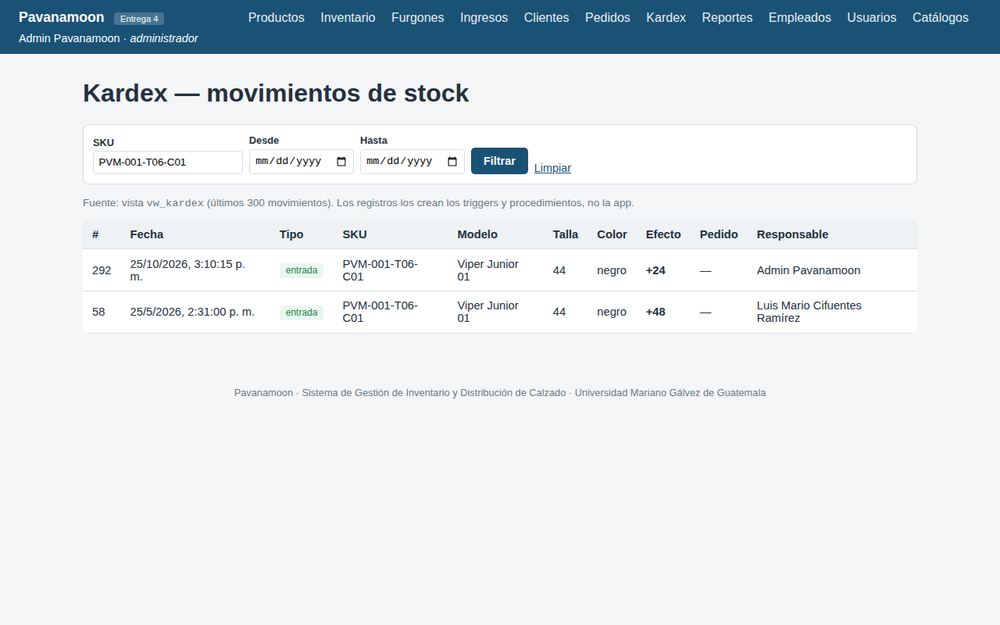

El mismo kardex después de vender una caja y recibir una devolución de 2
pares (sección 5):

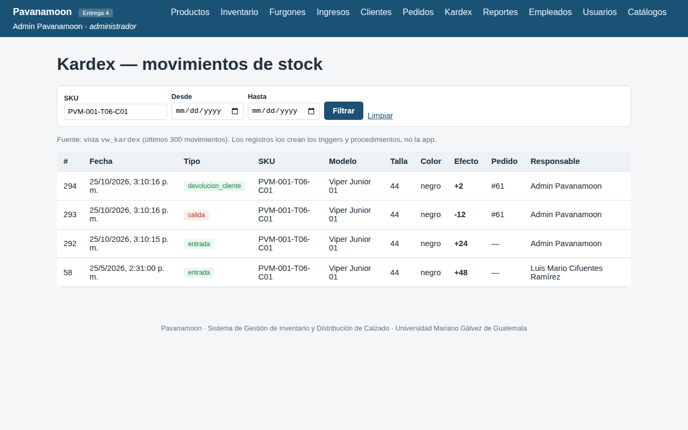

---

## 5. Ventas

### 5.1 Clientes

Los clientes son **individuales** o **mayoristas**. El tipo de cliente define
el descuento que se aplica en cada pedido.

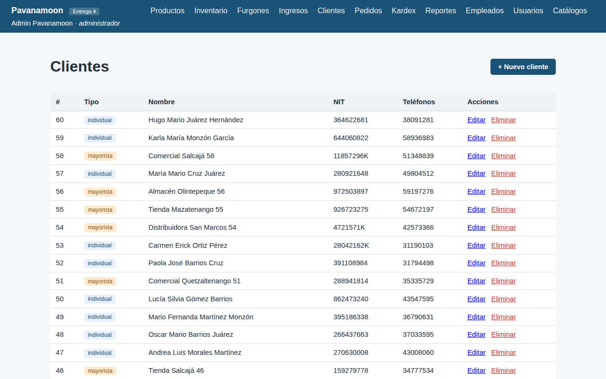

Para crear uno, pulse **Nuevo** y llene Tipo de cliente, Nombre y **NIT** (no
puede repetirse). En **Teléfonos** escriba un número por línea, hasta 5.

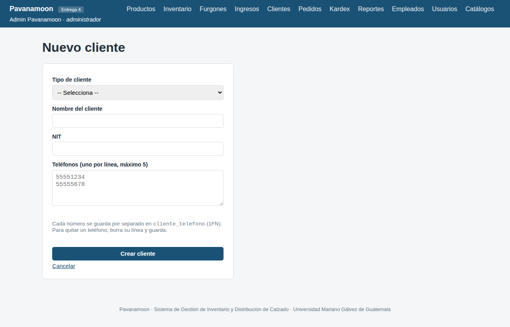

### 5.2 Crear un pedido

1. Abra **Pedidos** y pulse **Nuevo**.
2. Elija el **Cliente**.
3. En cada fila, elija la **Variante** (junto a cada una se ve el stock
   disponible), la **Presentación** (*unidad* = 1 par, *caja* = 12 pares) y la
   **Cantidad**.
4. Pulse **Registrar pedido**.

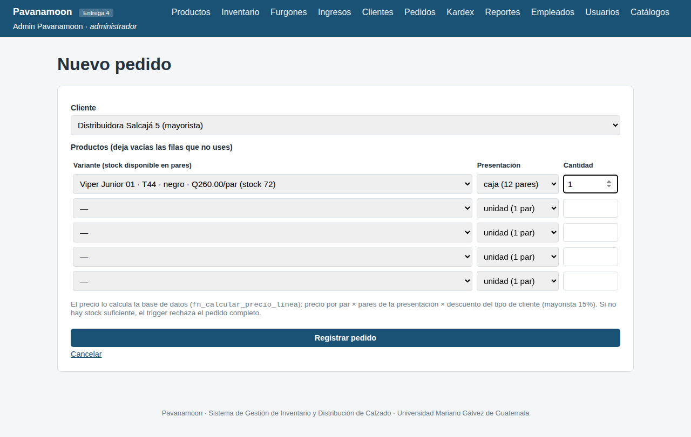

**El precio no se escribe: lo calcula el sistema** con la fórmula precio por
par × pares de la presentación × (1 − descuento del tipo de cliente). En el
ejemplo, el cliente mayorista (15 %) compra 1 caja de un modelo de Q260.00
por par: 260 × 12 × 0.85 = **Q2,652.00**.

Al registrarse, el pedido queda **pendiente**, el stock baja y el kardex
registra la `salida`.

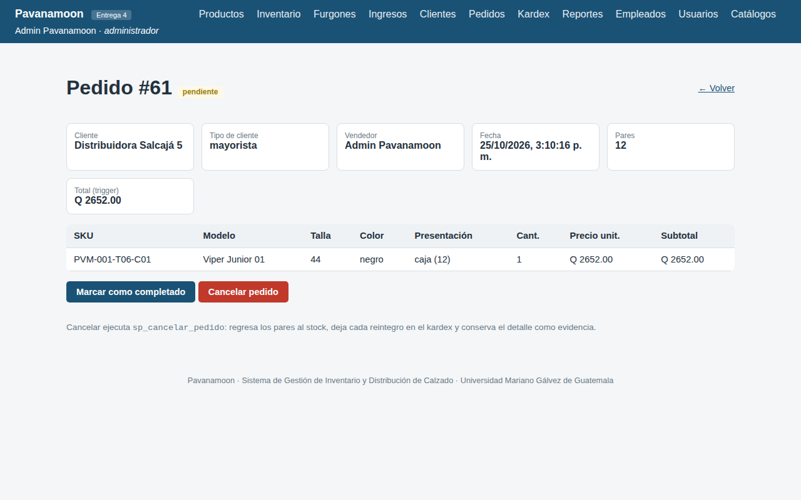

Si no hay stock suficiente, **el pedido completo se rechaza** y no se
descuenta nada:

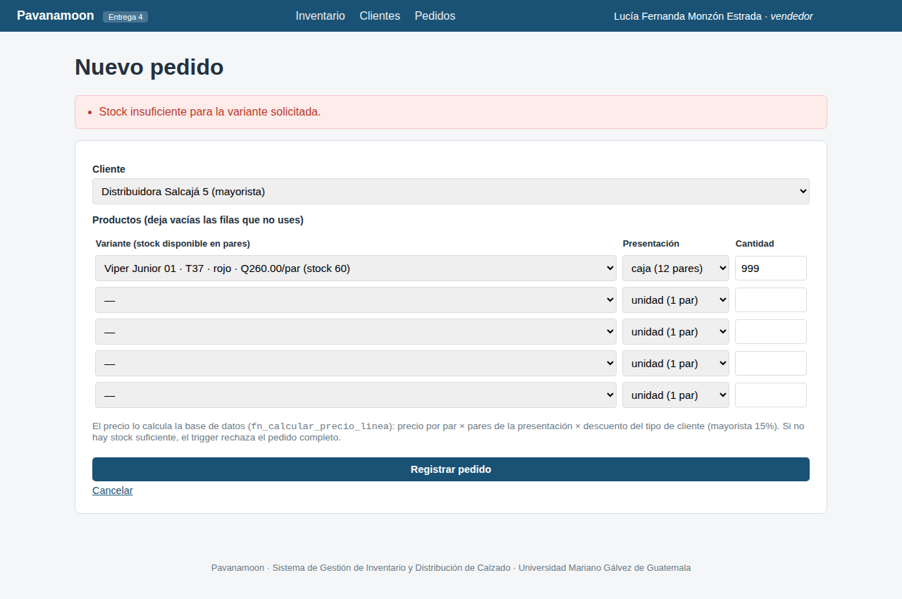

### 5.3 Completar un pedido

Cuando el pedido se entrega al cliente, abra su detalle y pulse **Marcar como
completado**. Solo los pedidos completados cuentan como venta en los reportes
y admiten devoluciones.

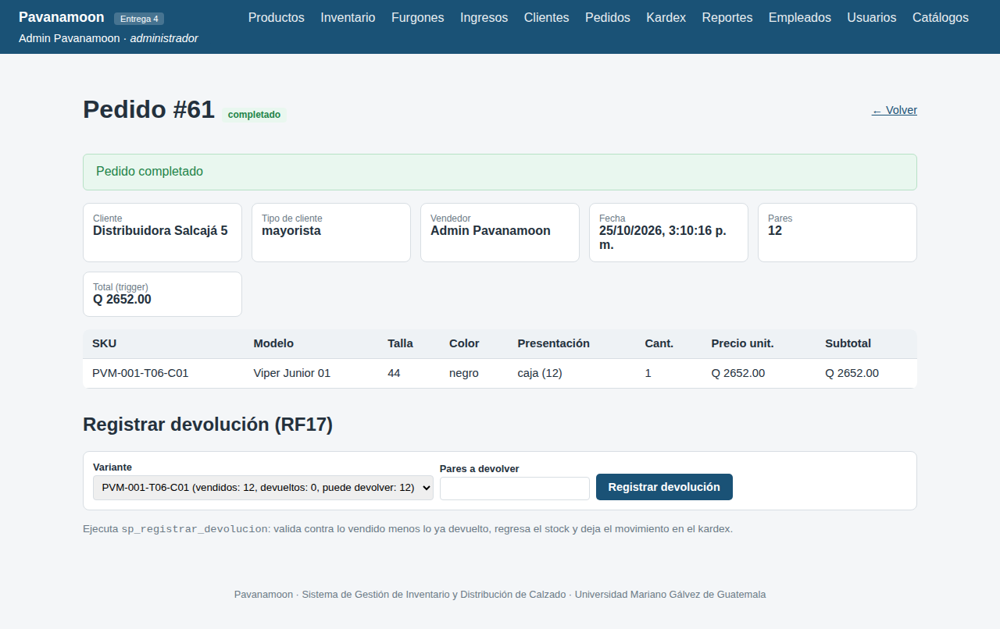

### 5.4 Registrar una devolución

En el detalle de un pedido **completado**, sección **Registrar devolución**:

1. Elija la **Variante**. La lista muestra cuántos pares se vendieron, cuántos
   ya se devolvieron y cuántos se pueden devolver todavía.
2. Escriba los **Pares a devolver**.
3. Pulse **Registrar devolución**.

Los pares vuelven al stock y el kardex registra `devolucion_cliente`. No se
puede devolver más de lo comprado menos lo ya devuelto (RF17).

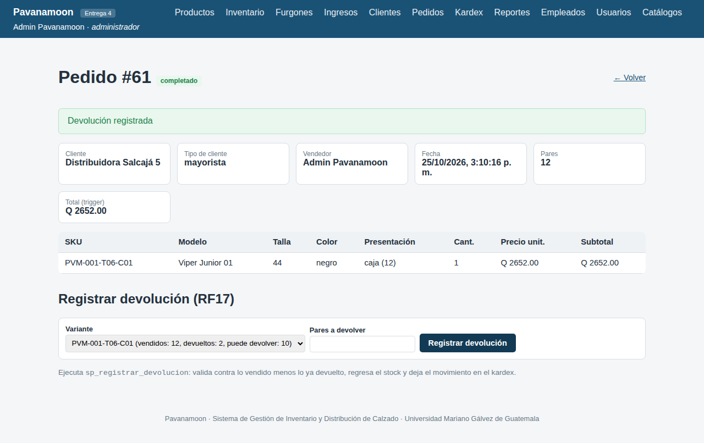

### 5.5 Cancelar un pedido

Solo un pedido **pendiente** se puede cancelar, cuando el cliente desiste
antes de la entrega. En su detalle, pulse **Cancelar pedido** y confirme.
Todo el stock vuelve, el kardex registra `cancelacion` y el pedido queda
**cancelado**. Su detalle se conserva como evidencia.

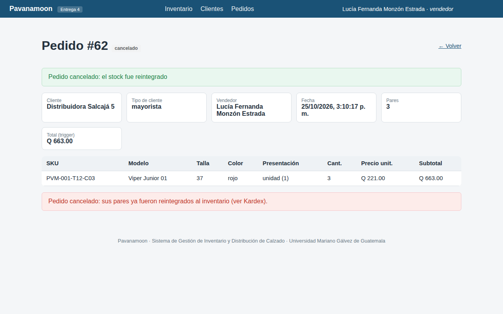

> Un pedido completado no se cancela: para él se usa la **devolución**.

### 5.6 Historial de pedidos por cliente

En **Pedidos**, sección **Historial por cliente**, elija el cliente y pulse
**Filtrar** (RF14). La lista muestra fecha, tipo de cliente, vendedor, pares,
total y estado.

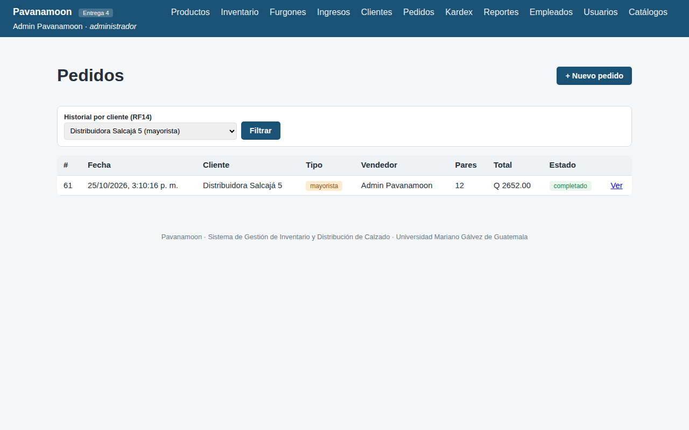

---

## 6. Reportes

*(Solo el administrador.)* Elija el periodo (**Desde** y **Hasta**), el
**Ranking** (más o menos vendidos) y cuántos modelos **Mostrar**, y pulse
**Aplicar**.

- **Ventas del periodo:** total y pares por día (o por mes). **Solo cuentan
  los pedidos completados.**
- **Ranking de modelos:** pares vendidos, devueltos, netos y monto por modelo.

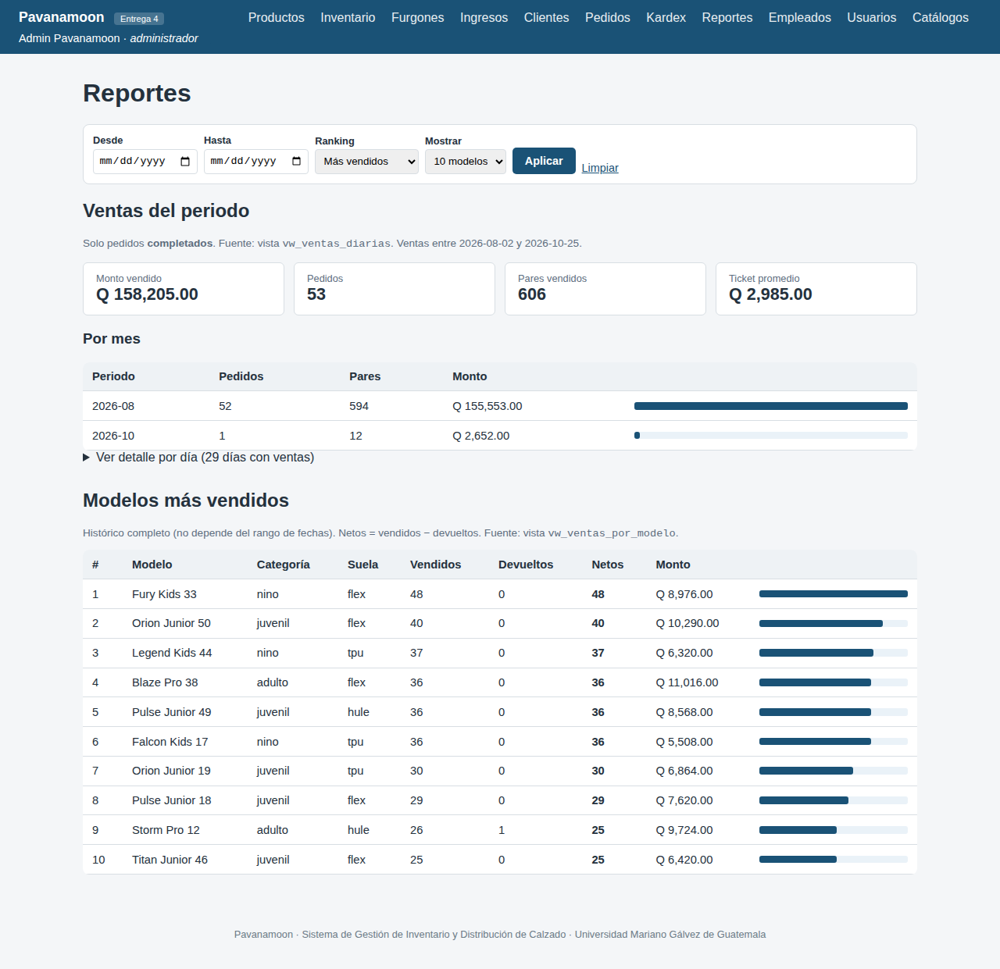

---

## 7. Administración

*(Solo el administrador.)*

### 7.1 Empleados

Puede buscar por nombre o DPI, crear, editar y eliminar empleados. El DPI
tiene 13 dígitos y no puede repetirse; cada empleado admite hasta 5
teléfonos. Un empleado con usuario no se puede eliminar: primero elimine o
reasigne su usuario.

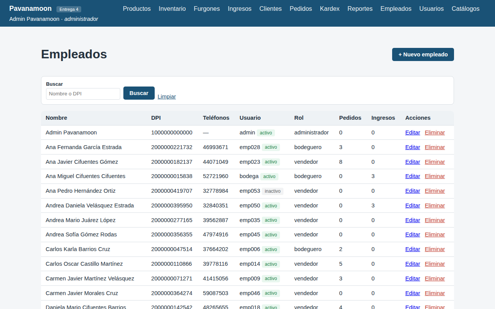

### 7.2 Usuarios

Cada usuario pertenece a un empleado y tiene **un rol**: administrador,
bodeguero o vendedor.

- **Nuevo:** elija Empleado, Nombre de usuario (no puede repetirse), Rol,
  Estado y la contraseña con su confirmación.
- **Editar:** cambie el rol o el estado (activo o inactivo), o asigne una
  **contraseña nueva** escribiéndola en los dos campos. Si deja la contraseña
  vacía, se conserva la actual. Los cambios de rol o de estado se aplican
  **aunque el usuario tenga la sesión abierta**.
- Un administrador no puede desactivarse ni quitarse el rol a sí mismo, y el
  sistema siempre conserva al menos un administrador activo.

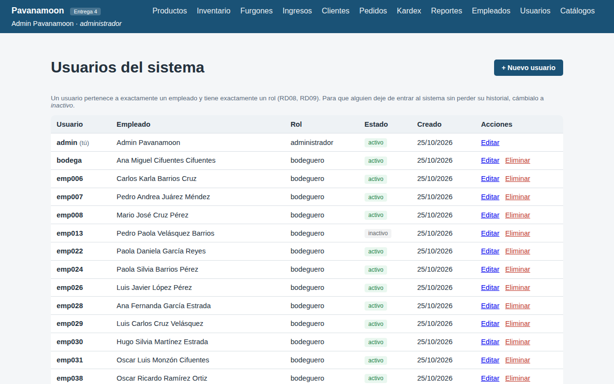
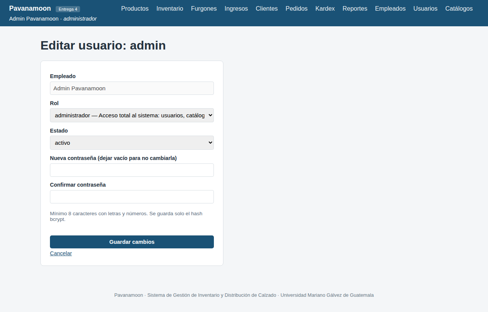

### 7.3 Catálogos

Pestañas: **Categorías, Tallas, Colores, Tipos de cliente** (con su
**descuento %**, que se aplica a los pedidos nuevos) y **Presentaciones**
(pares por presentación). Un elemento en uso no se elimina; las
presentaciones con historial se desactivan.

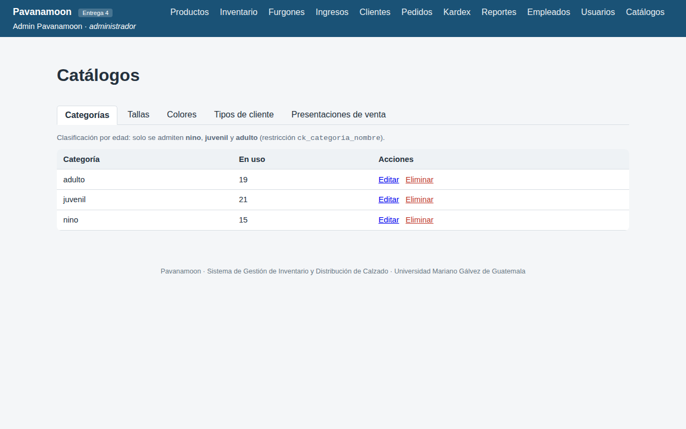

---

## 8. Mensajes frecuentes

| Mensaje | Qué significa | Qué hacer |
|---|---|---|
| Stock insuficiente para la variante solicitada | Se pidió más de lo que hay | Reduzca la cantidad o espere un ingreso |
| Solo se pueden cancelar pedidos pendientes… | El pedido ya está completado o cancelado | Si está completado, registre una devolución |
| Cantidad a devolver inválida… | Más pares de los que quedan por devolver, o 0 | Revise el número que muestra la lista de variantes |
| Acceso denegado | Ese módulo no corresponde a su rol | Use el menú, o pida otro rol al administrador |
| Demasiados intentos fallidos. Espera N minuto(s)… | Varios inicios de sesión fallidos | Espere el tiempo indicado |
| El NIT / DPI / usuario ya existe | El dato debe ser único | Revise si ya está registrado |

## 9. Preguntas frecuentes

**¿Por qué no puedo editar o borrar un pedido o un ingreso?**
Porque ya movieron el stock y quedaron en el kardex. Un pedido se corrige con
**cancelación** (si está pendiente) o con **devolución** (si está completado).

**¿En qué hora se muestran las fechas?**
En hora de Guatemala. En **Reportes**, una venta registrada después de las
6:00 p. m. puede aparecer en el día siguiente, porque el servidor agrupa las
ventas por la fecha UTC.

**Olvidé mi contraseña.**
Pida al administrador que le asigne una nueva desde **Usuarios → Editar**.
